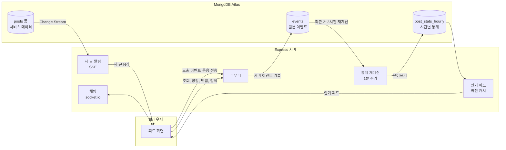

# community-feed

게시판 기반 커뮤니티 서비스에 **사용자 행동 이벤트 수집 파이프라인**을 붙이고, 그 데이터로 **인기 피드**를 만든 프로젝트임.
가장 단순한 구현에서 출발해, 데이터를 늘려가며 문제를 측정하고, 원인을 분석해 단계적으로 개선했음.

| 항목 | 결과 |
|---|---|
| 인기 피드 응답 시간 (이벤트 100만 개) | **980ms → 103ms** (약 9.5배) |
| 인기 피드 응답 시간 (이벤트 300만 개) | **3,487ms → 208ms** (약 16.8배) |
| 동시 연결 50개 처리량 (이벤트 100만 개) | **초당 28건 → 1,345건**, p99 3,058ms → 49ms |
| 데이터 품질 검사 탐지 정확도 | 개수를 아는 이상 데이터 6종을 섞어 **모두 정확히 탐지** |
| 데이터 품질 검사 시간 (글 20만 개) | **27.7초 → 1.1초** |
| 동시 요청 정합성 (가입, 공감, 댓글 삭제) | 단순한 구현은 100회 중 **100회 모두 틀어짐**, 채택한 구현은 **0회** |
| 깊은 페이지 이동 (글 20만 개, 1만 번째 페이지) | skip **355.3ms** → 커서 **0.5ms** |
| 테스트 | 통합 테스트 89개 (동시 요청, 실시간 스트림, 소켓, 데이터 품질 포함) |

- 개선 과정 전체: [docs/problem-solving.md](docs/problem-solving.md)
- 설계 결정과 대안 비교: [docs/design-decisions.md](docs/design-decisions.md)

---

## 주요 기능

**커뮤니티 서비스**
- 회원가입, 로그인 (세션 기반)
- 게시판별 글쓰기, 수정, 삭제, 이미지 첨부 (S3)
- 댓글, 공감
- 한국어 형태소 분석 검색 (Atlas Search)
- 피드를 보는 중 새 글 알림 (Change Stream + SSE)
- 글 작성자에게 1:1 문의 채팅 (socket.io)

**데이터 파이프라인**
- 행동 이벤트 수집: 피드 노출, 조회, 공감, 댓글, 검색, 채팅 요청
- 1분마다 원본 이벤트를 글별, 시간별 통계로 재계산
- 최근 24시간 행동 기반 인기 피드
- 데이터 품질 검사 7종 (10분 주기, 결과 저장과 경고)
- 수집 현황 확인, 테스트 데이터 생성, 성능 측정 스크립트

## 기술 스택

| 분류 | 기술 | 쓰는 곳 |
|---|---|---|
| 서버 | Node.js 22, Express 5 | 웹 서버, 화면 렌더링(EJS) |
| DB | MongoDB Atlas | 서비스 데이터, 이벤트, 시간별 통계, 세션 |
| 검색 | Atlas Search (lucene.korean) | 제목, 내용 검색 |
| 실시간 | Change Stream, SSE, socket.io | 새 글 알림, 채팅 |
| 인증 | passport-local, express-session, bcrypt | 세션 로그인 |
| 파일 | AWS S3, multer-s3 | 이미지 업로드 |
| 테스트·측정 | node:test, mongodb-memory-server, autocannon | 통합 테스트, 부하 측정 |

새 기술은 필요가 측정으로 확인된 경우에만 추가했음. 예를 들어 결과 캐시는 서버 메모리로 충분해 Redis를 쓰지 않았음([결정 11](docs/design-decisions.md)).

## 구조



**이벤트는 기록 주체를 나눴음.** 글이 화면에 실제로 보였는지는 브라우저만 알기 때문에 노출은 브라우저가 모아서 보냄. 조회, 공감, 댓글은 서버가 직접 기록해 조작할 수 없게 했음. 이벤트 기록이 실패해도 사용자 요청은 정상 처리됨.

---

## 핵심 이야기: 인기 피드가 이벤트 수에 비례해 느려지는 문제

### Problem
행동 데이터로 "최근 24시간 동안 조회, 공감, 댓글이 많았던 글"을 보여주고 싶었음.

### Initial Design
요청이 올 때마다 최근 24시간 이벤트를 글별로 집계해 점수(조회 1, 공감 3, 댓글 5)순으로 정렬했음. 가장 단순하고 결과가 항상 최신인 방식임.

### Problem Found
지프 분포로 쏠림을 반영한 테스트 데이터를 만들어 측정했음. 응답 시간이 24시간 내 이벤트 수에 거의 정비례했고, 이벤트 100만 개에서 약 1초, 300만 개에서 약 3.5초가 걸렸음.

### Analysis
실행 계획을 보니 인덱스는 쓰고 있었지만, 24시간 범위 안의 이벤트를 **전부** 읽고 있었음. 문서 본체까지 꺼내 왔고, 점수에 쓰지 않는 노출 이벤트(전체의 70%)도 함께 읽혔음. 그리고 순위는 몇 초 사이에 거의 바뀌지 않는데 요청마다 같은 계산을 반복했음.

### Solution
네 가지 후보(커버링 인덱스, 결과 캐시, 시간 단위 사전 집계, 순위 스냅샷)를 비교하고 세 단계로 개선했음.

1. **커버링 인덱스와 필드 순서.** 집계에 필요한 필드를 모두 담은 인덱스로 문서 읽기를 없앴음. 필드 순서 두 가지를 같은 데이터로 측정해, 같음 조건(종류)을 앞에 둔 순서가 읽는 인덱스 키를 70% 줄이는 것을 확인했음.
2. **시간 단위 사전 집계.** 글별, 시간별 통계를 1분마다 원본 이벤트로 다시 계산해 덮어쓰고, 인기 피드는 최근 24칸만 더함. 덮어쓰기라 몇 번 실행해도 결과가 같고, 원본으로 언제든 복구할 수 있음. 측정한 모든 크기에서 기존 방식과 순위가 정확히 일치했음.
3. **통계 버전 기준 결과 캐시.** 통계가 갱신될 때마다 버전을 올리고, 같은 버전이면 계산 결과를 재사용함. 시간 기준 캐시와 달리 추가 지연이 없고, 캐시가 빈 순간 요청이 몰려도 계산은 한 번만 함.

### Result

| 전체 이벤트 | 기존 | 1차: 커버링 인덱스 | 2차: 시간별 통계 |
|---|---|---|---|
| 10만 | 82ms | 23ms | 18ms |
| 100만 | 980ms | 206ms | 103ms |
| 300만 | 3,487ms | 525ms | 208ms |

| 동시 연결 50개, 이벤트 100만 개 | 초당 처리 요청 | p99 |
|---|---|---|
| 1차: 원본 이벤트 집계 | 28 | 3,058ms |
| 2차: 시간별 통계 | 63 | 1,419ms |
| 3차: 시간별 통계 + 결과 캐시 | 1,345 | 49ms |

읽는 양이 "이벤트 수"에서 "활동한 (글, 시간) 칸 수"로 바뀌었음. 24시간 내 이벤트가 30배 늘 때 응답 시간은 11.4배 늘었음.

### Trade-off
- 인기 순위가 최대 1분 늦음.
- 계산이 요청 경로에서 1분 주기 작업으로 옮겨졌음(이벤트 100만 개 기준 1회 128ms).
- 직전 시간보다 오래된 칸은 확정으로 보므로, 아주 늦게 저장된 이벤트는 전체 재계산 전까지 반영되지 않음.
- 서버가 여러 대가 되면 각 서버가 같은 통계 갱신을 반복함.

측정 환경, 원본 수치, 측정 중 발견한 렌더링 병목은 [문제 해결 기록 1번](docs/problem-solving.md)에 있음.

## 설계 단계에서 예상한 문제와 검증

구현하면서 문제가 될 것 같은 지점을 골라, **단순한 구현과 채택한 구현을 같은 조건에서 직접 재현해 비교했음.** 채택한 구현이 맞다는 것만이 아니라, 단순한 구현이 실제로 얼마나 틀어지는지를 숫자로 확인하기 위함.

| 예상한 문제 | 재현 방법 | 단순한 구현 | 채택한 구현 |
|---|---|---|---|
| 같은 아이디로 동시에 가입하면 계정이 중복됨 | 같은 아이디로 동시 요청 50개, 100회 반복 | 조회 후 저장: **100회 모두 중복**, 평균 계정 41.9개 생성 | 고유 인덱스: 중복 0회, 항상 1개 |
| 공감 버튼을 연타하면 공감 수가 부풀려짐 | 한 사람이 동시 요청 20개, 100회 반복 | 조회 후 저장하고 증가: 평균 공감 수 **15.9** (정답 1) | 고유 인덱스, 새로 생겼을 때만 증가: 항상 1 |
| 같은 댓글을 동시에 지우면 댓글 수가 여러 번 줄어듦 | 동시 삭제 요청 5개, 100회 반복 (댓글 수 10) | 무조건 감소: 평균 **5** (정답 9) | 실제로 지워졌을 때만 감소: 항상 9 |
| 페이지가 깊어질수록 피드가 느려짐 | 글 20만 개, 1·100·1,000·5,000·10,000번째 페이지 | skip: 1만 번째 페이지 **355.3ms**, 문서 20만 개 읽음 | 커서: 모든 페이지 0.6ms 이하, 문서 21개 이하 |
| 피드마다 공감·댓글 수를 세면 느려짐 | 글 20개 피드, 글당 공감 5,000개, 댓글 1,000개 | 읽을 때 세기: **11ms**, 쿼리 41번 | 글에 저장한 값: 0.3ms, 쿼리 1번 |
| 브라우저가 가짜 이벤트로 순위를 조작함 | 활동 없는 글에 가짜 공감 이벤트 1,000건 전송 | 그대로 저장: 그 글이 **1위** (3,000점, 실제 1위는 30점) | 노출만 받고 검증: 0건 저장, 순위 변화 없음 |

**채택한 방식이 치르는 비용도 함께 쟀음.**
- 공감 수를 글에 저장하면 공감 한 번의 쓰기 시간이 0.233ms에서 0.465ms로 약 2배가 됨. 피드 읽기가 공감보다 훨씬 많아서 감수함. 두 쓰기 사이에 실패하면 숫자가 어긋날 수 있어 데이터 품질 검사로 탐지함.
- 커서 방식은 특정 페이지 번호로 바로 이동할 수 없음.
- 노출 이벤트는 형식만 맞으면 받으므로 가짜 노출 1,000건은 저장됨. 노출은 점수에 넣지 않아 순위는 변하지 않았음.

측정은 단일 로컬 MongoDB에서 DB 쿼리 수준으로 재현한 결과임(`npm run bench:design`, 결과: `bench-results/design-validation.json`). 동시 요청과 이벤트 검증은 HTTP 요청 기준 통합 테스트로도 고정했음.

## 그 밖의 문제 해결

| 문제 | 검토한 대안 | 선택과 근거 |
|---|---|---|
| 학습용 코드의 권한 검사 누락, 소켓 인증 부재, XSS | 라우트마다 if문 / 공통 미들웨어 | 공통 미들웨어와 소켓 연결 시점의 세션 인증. 남의 글 수정·삭제 403, 비참여자 채팅방 입장 거절, 태그 escape를 통합 테스트로 고정 |
| 공개 저장소에 DB 접속 정보 노출 | 히스토리에서 삭제 / 비밀번호 교체 | 이미 복사됐을 수 있어 교체를 우선함. 환경변수로 분리하고, 필수 값이 없으면 시작 단계에서 실패하게 함 |
| 테스트용 DB 기동 실패 | 동시 실행 수 제한 / 자원 확인 | 처음엔 동시 실행 문제로 판단해 제한했으나 재발. 디스크 여유 642MB, 측정 임시 데이터 6.1GB를 찾아 정리 로직을 고침 |
| 데이터 품질 검사가 글 수에 비례해 느려짐 | 매번 전체 검사 / 최근 변경된 글만 검사 | 숫자는 공감·댓글을 쓸 때만 어긋나므로 최근 변경된 글만 확인. 글 20만 개 기준 27.7초 → 1.1초. DB를 직접 고친 경우는 전체 검사 명령으로 잡음 |

자세한 과정은 [docs/problem-solving.md](docs/problem-solving.md)에 있음.

## 데이터 모델

| 컬렉션 | 내용 | 주요 인덱스 |
|---|---|---|
| users | 아이디, 비밀번호 해시, 닉네임 | username 고유 |
| posts | 게시판, 제목, 내용, 이미지, 공감·댓글 수 | (board, _id), Atlas Search |
| comments | 글 id, 작성자, 내용 | (postId, _id) |
| likes | 글 id, 유저 id | (postId, userId) 고유 |
| events | 종류, 유저, 글, 화면, 발생·수신 시각 | (type, receivedAt, postId) |
| post_stats_hourly | 글별, 시간별 조회·공감·댓글 수 | hour |
| chatRooms, chatMessages | 1:1 문의방, 메시지 | (postId, requesterId) 고유 |

MongoDB 하나만 쓴 이유와 관계형 DB였다면 달라지는 점은 [결정 1](docs/design-decisions.md)에 정리했음.

---

## 실행 방법

**필요한 것:** Node.js 20 이상, MongoDB Atlas 클러스터 (검색과 실시간 알림에 필요)

```bash
npm install
cp .env.example .env      # Windows: copy .env.example .env, 이후 MONGO_URL, SESSION_SECRET 등을 채움
npm run search:index      # Atlas Search 인덱스 생성 (처음 한 번)
npm run dev               # http://localhost:8080
```

이미지 업로드는 선택 사항임. `.env`에 S3 정보가 없으면 업로드 없이 동작함.

**테스트**

```bash
npm test
```

테스트마다 인메모리 MongoDB를 띄우므로 Atlas 없이 실행됨. 실시간 알림 테스트는 노드 하나짜리 레플리카 셋으로 실행함.

**측정 재현**

```bash
npm run bench:popular                       # 인기 피드 단건 응답 시간 (10만, 30만, 100만)
BENCH_MODE=events npm run bench:popular     # 이전 방식(원본 이벤트 집계) 측정
npm run bench:load                          # 동시 연결 부하 측정
npm run events:recent                       # 최근 수집된 이벤트 확인
npm run bench:dq                            # 이상 데이터를 섞어 데이터 품질 검사 정확도와 시간 측정
npm run bench:design                        # 설계 단계 문제를 단순한 구현과 채택한 구현으로 재현해 비교
npm run dq:check                            # 데이터 품질 검사 실행 (--full: 모든 글 확인)
npm run dq:fix-counts                       # 어긋난 공감·댓글 수 목록 확인 (--apply: 실제로 고침)
```

측정은 매번 임시 MongoDB를 새로 띄워 같은 시드의 데이터로 진행하고, 결과는 `bench-results/`에 저장됨.

## 프로젝트 구조

```text
src/
  routes/        요청 처리 (인증, 게시글, 댓글·공감, 이벤트, 검색, 채팅, SSE)
  services/      데이터 로직 (게시글, 이벤트, 시간별 통계, 인기 피드, 검색, 채팅)
  realtime/      새 글 알림(Change Stream + SSE), 채팅(socket.io)
  jobs/          1분 주기 통계 재계산
  auth/          passport 설정
views/           EJS 화면
public/js/       노출 수집, 공감, 새 글 알림, 채팅 스크립트
scripts/         테스트 데이터 생성, 성능 측정, 검색 인덱스 생성, 데이터 품질 검사
test/            통합 테스트
docs/            문제 해결 기록, 설계 결정 기록
bench-results/   측정 원본 결과
```

## 한계와 다음 단계

- 인기 점수 가중치는 가설임. 노출 대비 클릭률과 채팅 요청을 반영하고, 가중치를 데이터로 검증하는 것이 다음 과제임.
- 노출 이벤트는 유실을 감수하는 "최대 한 번" 전달임. 재전송을 넣으려면 이벤트 id 기반 중복 제거가 필요함.
- 새로고침 반복 조회는 데이터 품질 검사로 탐지하지만, 인기 점수에서 걸러내지는 않음. 사용자별 중복 조회를 점수에서 빼는 것이 다음 과제임.
- 공감 문서와 공감 수는 별개의 쓰기라 어긋날 수 있음. 데이터 품질 검사로 탐지하고 확인 후 바로잡는 명령은 있지만, 트랜잭션으로 어긋남 자체를 막지는 않음.
- 데이터 품질 경고 기준값은 가설임. 실제 트래픽에서 오탐과 미탐을 보며 조정해야 함.
- 서버가 여러 대가 되면 통계 작업의 단일 실행 보장, 채팅의 서버 간 메시지 전달이 필요함.
